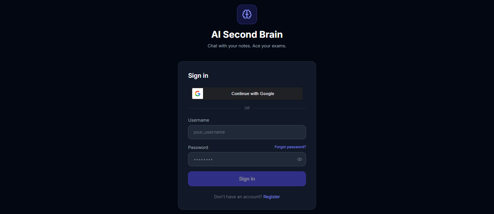
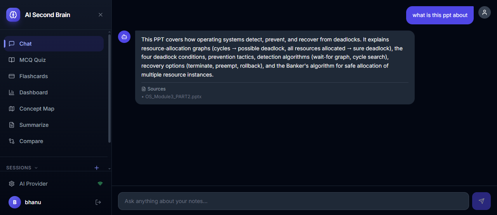
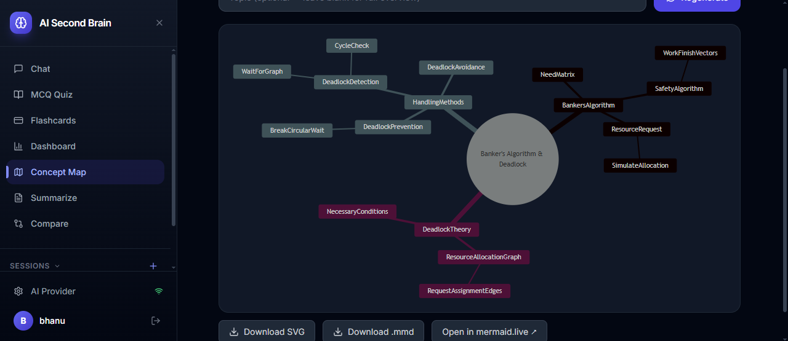
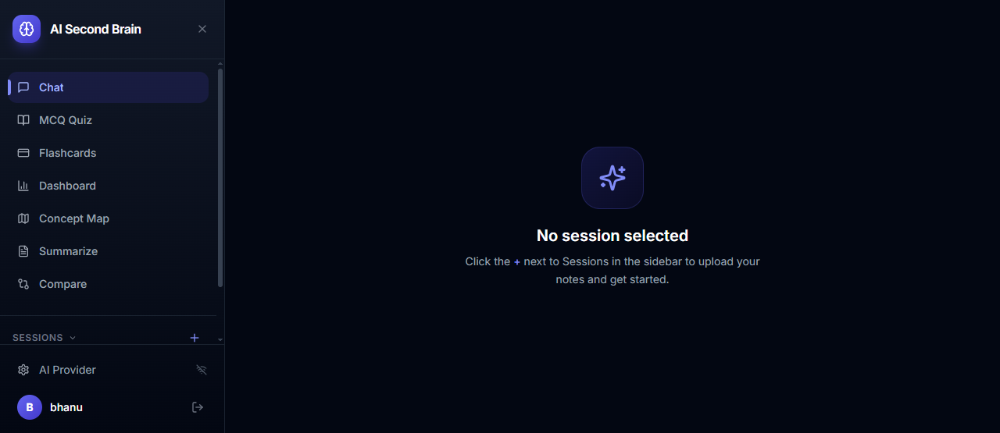

# 🧠 AI Second Brain

> Chat with your own notes. Upload PDFs, slides or YouTube lectures, then ask questions, take quizzes, and generate flashcards and concept maps, powered by Retrieval-Augmented Generation (RAG).


## Screenshots

| Login page | Chat  |
|---|---|
|  |  |

| Concept map | Dashboard |
|---|---|
|  |  |

## Features

- 💬 **Chat with your notes**: answers come from your material, with source citations
- 📝 **MCQ quizzes**: questions are regenerated with extra focus on topics you missed
- 🃏 **Flashcards**: exportable as CSV for Anki
- 🗺️ **Concept maps**: generated as Mermaid diagrams and rendered in the browser
- 📊 **Dashboard**: score history and per-topic performance charts
- 📄 **Summarize and compare** topics across your notes
- 🎥 **YouTube lectures**: index a video's transcript
- 🔑 **8 LLM providers**: Ollama (local, free, offline) or your own key for Groq, Gemini, OpenAI, Anthropic, Mistral, Cohere or Together AI
- 🔐 **Auth**: username and password, Google Sign-In, password reset by email
- 🚦 **Rate limiting** and retry with backoff on LLM calls
- 🗄️ **Persistence**: PostgreSQL for users and history, ChromaDB on disk for vectors

## How it works (RAG)

1. **Ingest**: PDFs, PowerPoint files and YouTube transcripts are parsed to text
2. **Chunk**: text is split into 500-word chunks with a 50-word overlap
3. **Embed**: each chunk is embedded locally with ChromaDB's default model (all-MiniLM-L6-v2)
4. **Store**: vectors go into a persistent ChromaDB collection, one per session
5. **Retrieve**: your question is embedded and the most similar chunks are fetched
6. **Generate**: the chunks and your question go to the selected LLM with the instruction to answer only from your notes
7. **Cite**: the source file names are returned with the answer

No model is trained or fine-tuned. The project uses pretrained LLMs and embeddings.

## Tech stack

| Area | Technologies |
|---|---|
| GenAI / RAG | Pretrained LLMs (8 providers), prompt engineering, ChromaDB, sentence embeddings, Ollama |
| Backend | Python, FastAPI, Pydantic, PostgreSQL (psycopg2), JWT, PBKDF2, Google OAuth 2.0, SMTP |
| Frontend | React 18, TypeScript, Vite, Tailwind CSS, Zustand, Recharts, Mermaid.js |
| DevOps | Docker, Docker Compose, Caddy (reverse proxy, automatic HTTPS), GitHub Actions, pytest, AWS EC2 |

## Project structure

```
second-brain/
├── docker-compose.prod.yml      Production stack: Postgres + API + web
├── second-brain-ai/             FastAPI backend
│   ├── api/                     Routes, schemas, dependencies
│   ├── src/                     DB, LLM brain, features, utilities
│   └── tests/                   pytest suite
└── second-brain-frontend/       React + TypeScript frontend
    ├── src/
    ├── Dockerfile               Builds the app and serves it with Caddy
    └── Caddyfile                Static files, /api proxy, optional HTTPS
```

## Run locally

**Backend** (needs PostgreSQL with a database named `second_brain`):
```bash
cd second-brain-ai
pip install -r requirements.txt
cp .env.example .env        # add your PostgreSQL password and a JWT secret
uvicorn api.main:app --reload --port 8000
```

**Frontend:**
```bash
cd second-brain-frontend
npm install
npm run dev                 # http://localhost:3000
```

**LLM provider:** pick one in the app's AI Provider settings.
- *Offline:* install [Ollama](https://ollama.com), run `ollama pull llama3.2` and `ollama serve`
- *Cloud:* paste your own API key (Groq has a free tier)

## Run with Docker

Create a `.env` file next to `docker-compose.prod.yml`:
```
DOMAIN=:80
POSTGRES_PASSWORD=choose-a-password
JWT_SECRET_KEY=a-long-random-string
FRONTEND_URL=http://localhost
CORS_ORIGINS=http://localhost
```
```bash
docker compose -f docker-compose.prod.yml up -d --build
```
Open `http://localhost`. If port 80 is taken, add `WEB_PORT=8080` to `.env` and use `http://localhost:8080` (and update the two URLs).

## Deploy on AWS EC2

1. Launch an Ubuntu 24.04 `t3.small` instance with about 25 GB of storage. Allow ports 22, 80 and 443.
2. Install Docker, clone this repo, and create the `.env` file shown above with the server's address.
3. Run `docker compose -f docker-compose.prod.yml up -d --build`.
4. For HTTPS and Google Sign-In, point a domain at the server and set `DOMAIN=your.domain`. Caddy obtains the certificate automatically. Add `https://your.domain` to Authorized JavaScript origins in Google Cloud Console.

Ollama is meant for local use. On a server, use a cloud provider key.

## Configuration

| Variable | Purpose |
|---|---|
| `DOMAIN` | `:80` for plain HTTP, or a domain name for automatic HTTPS |
| `POSTGRES_PASSWORD`, `JWT_SECRET_KEY` | Required secrets |
| `FRONTEND_URL`, `CORS_ORIGINS` | Public URL of the app |
| `GOOGLE_CLIENT_ID` | Optional, defaults to the project's client ID |
| `SMTP_HOST`, `SMTP_USER`, `SMTP_PASSWORD` | Optional, for password reset emails (links are logged if unset) |
| `WEB_PORT` | Optional, host port for the web service (default 80) |

## Tests

```bash
cd second-brain-ai
pytest tests/ -v
```

## Limitations

- Answer quality depends on the chosen LLM and the quality of your notes
- "Weak topics" is a keyword-frequency heuristic, not a trained model
- API keys are entered in the browser and sent with each request, so use HTTPS in any shared deployment
- The rate limiter keeps counts in memory, so it assumes a single backend process

## License

MIT. See [LICENSE](LICENSE).

Built by [Bhanu Prakash](https://github.com/bhanuchukka2005-spec).